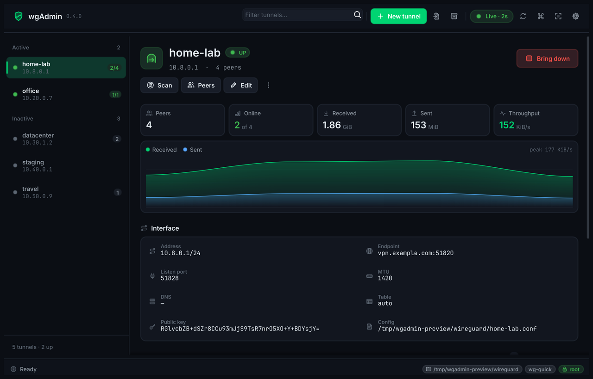
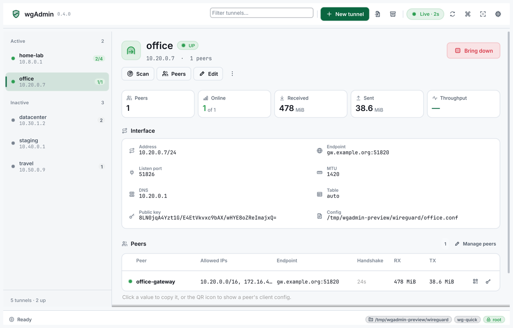
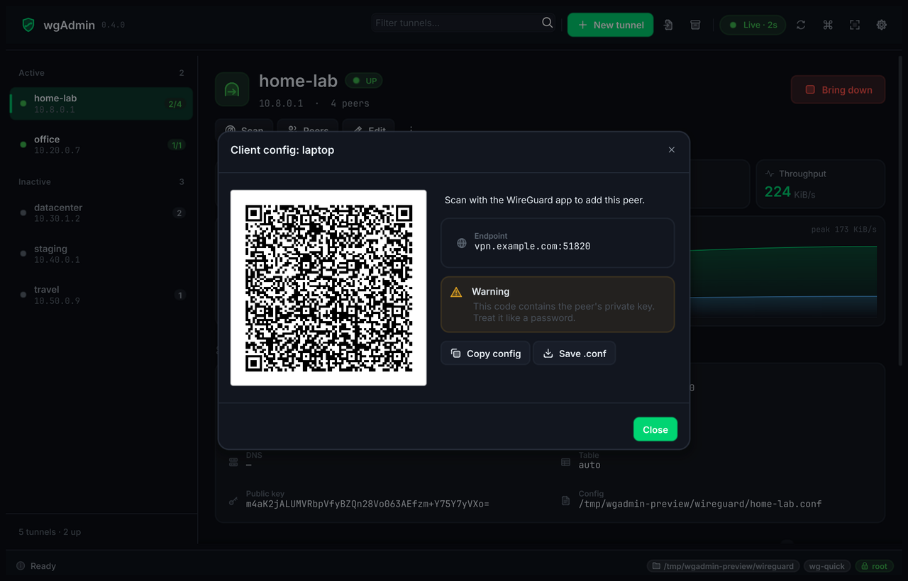
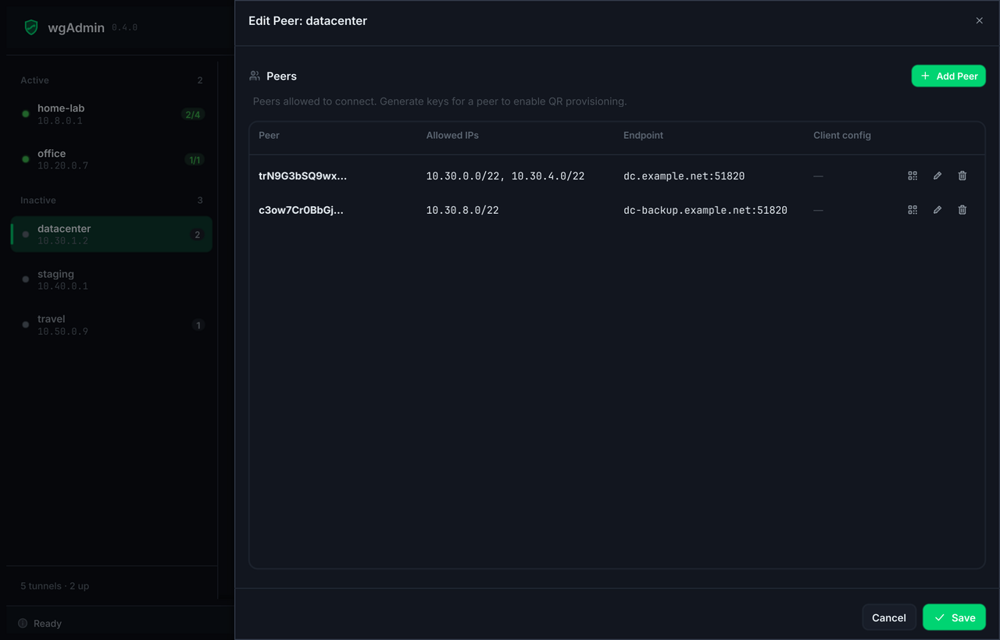
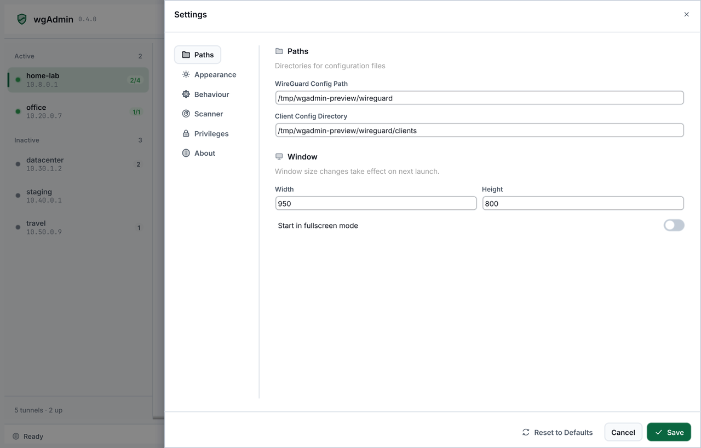
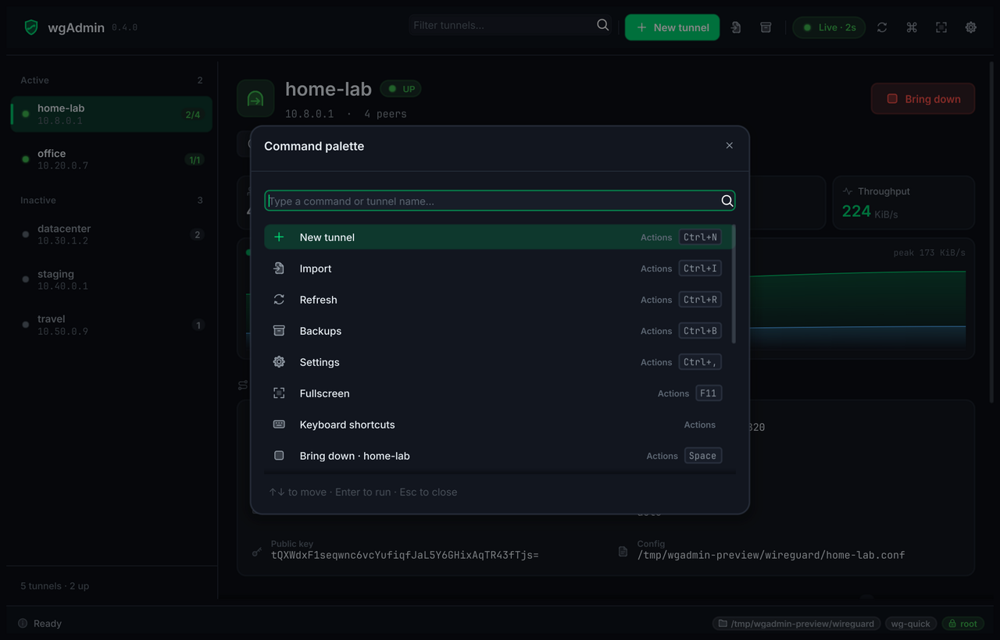

# wgAdmin

A GUI application for managing WireGuard VPN configurations on Linux.



<table>
  <tr>
    <td></td>
    <td></td>
  </tr>
  <tr>
    <td align="center">Light theme, peers with live handshakes and traffic</td>
    <td align="center">QR code and client config for any peer</td>
  </tr>
  <tr>
    <td></td>
    <td></td>
  </tr>
  <tr>
    <td align="center">Peer editor</td>
    <td align="center">Settings</td>
  </tr>
  <tr>
    <td colspan="2"></td>
  </tr>
  <tr>
    <td colspan="2" align="center">Command palette (Ctrl+K)</td>
  </tr>
</table>

<sub>Screenshots show invented demo data from <code>go run ./cmd/preview</code>; no real network is pictured.</sub>

## Features

- Create, edit, import and delete WireGuard tunnels
- Activate/deactivate interfaces
- Live telemetry when running as root: online peers, traffic counters and a throughput chart
- Click any interface value or peer cell to copy it
- QR codes and client configs for any peer whose keys wgAdmin generated
- Generate key pairs and preshared keys
- Manage multiple peers per tunnel
- Network scanner for discovering hosts in a CIDR range, with SSH from the results
- Auto-backup before every change, and restore from backup
- Command palette (Ctrl+K) and keyboard shortcuts for every action
- Dark and light themes, colour presets, compact density and a reduce-motion option

## Requirements

- ~~Linux with WireGuard installed (`wg`, `wg-quick`)~~
- Linux with wireguard module loaded
- Root privileges

__Building from source__
- [Go](https://go.dev/doc/install) >= 1.24.5
- [Fyne](fyne.io/fyne/v2) v2.7.0
- [Make](https://man7.org/linux/man-pages/man1/make.1.html)

## Installation
__Note:__ This is has only been tested with ubuntu based OS. Use `make build` and `./build/usr/local/bin/wgAdmin` if needed.

```bash
git clone https://github.com/MrVasquez96/wgAdmin
cd wgAdmin
make build install
```
1. Checks if `build/.build_done` file exists. 
2. Builds from source if missing and install destop app for linux.
4. Kopies binary, destop file and logo/ocon to dedicated folders for desktop apps in linux. 
3. The app should now be available in your desktop applications selection under `wgAdmin`.

## Development

The UI is built on its own design system in `internal/wgwidget` (buttons, tables, sheets, modals,
toasts, charts) and a duotone icon set generated from code. These tools help when working on it:

| Command | What it does |
|---|---|
| `go run ./cmd/preview` | Runs the real console against mock tunnels with simulated live traffic; no root or WireGuard needed. Flags: `-theme light`, `-select <tunnel>`, `-noroot`, `-compact`, `-open <screen>`, `-notips` |
| `go run ./cmd/gallery` | Shows every UI component in its states, in dark or light (`-theme light`) |
| `go run ./generate/icons/<batch>` | Regenerates the icons of one batch (`core`, `actions`, `fields`, `app`) into `internal/ui/theme/icons` |
| `go run ./generate/iconsheet` | Renders all icons into `iconsheet.png` for review |
| `go run ./generate/appicon` | Renders `icon.png` from the brand mark |

## License

MIT
